# GunPowdered

Gunpowder for Valheim: gather guano, water and sulfur, mill gunpowder, then build grenades, cannons, a musket, explosive arrows and dynamite.

## Features
Make gunpowder, then build weapons with it.

**Making gunpowder**
- **Bat Guano**: rare deposits in Troll Caves, Burial Chambers, mountain caves and Swamp bat caves; mine with any pickaxe.

  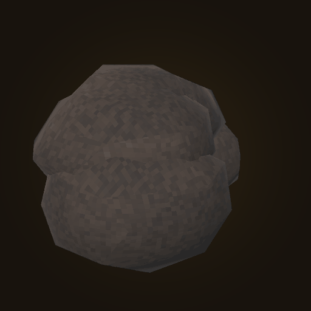 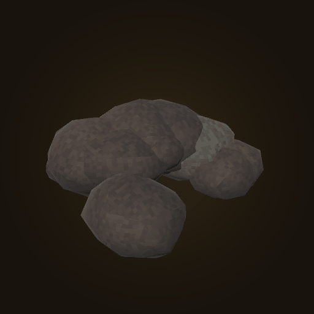

- **Water**: fill a Bucket in any water, or collect it in a **Rain Barrel** (fills only while it rains and nothing roofs it).

  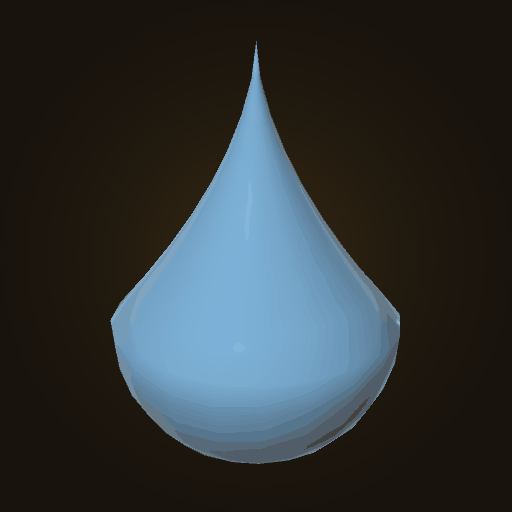 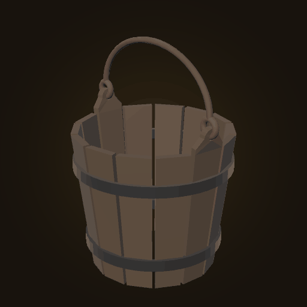 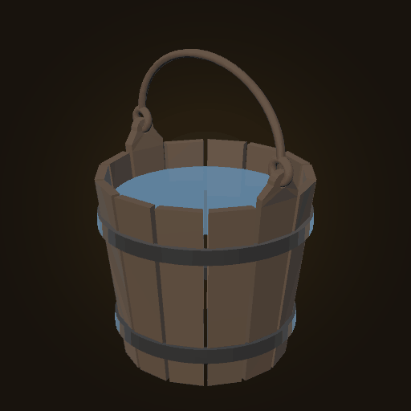 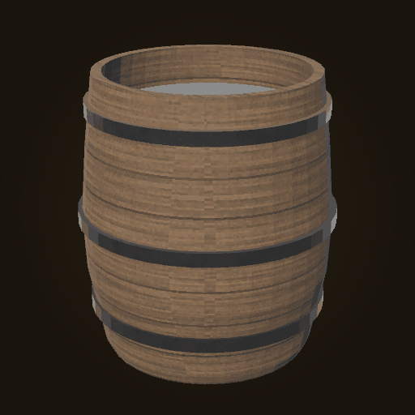

- **Leaching Station**: guano + water (+ wood for the hearth) make Saltpeter in one in-game day. It runs by itself while it holds at least 10 guano + 10 water + 4 wood, can be filled at any time, and the Saltpeter piles up until you take it. Five extension pieces, one per biome from the Swamp to the Ashlands, upgrade it: each makes the batch bigger and the run 5 minutes shorter (biggest: 60 guano + 60 water -> 30 Saltpeter in 5 minutes).

  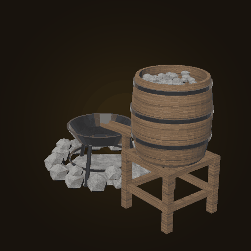 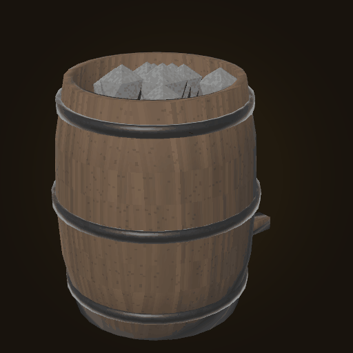 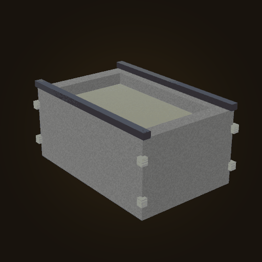 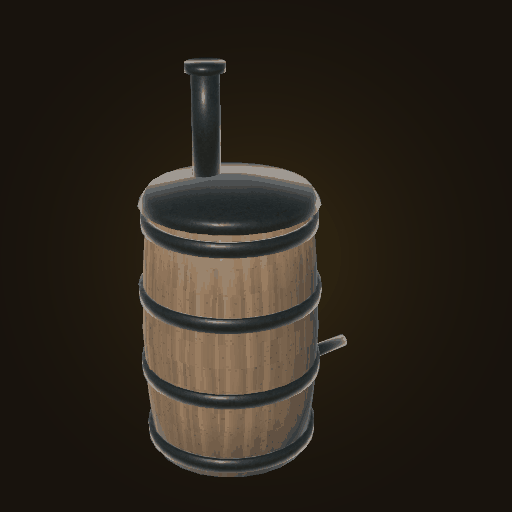 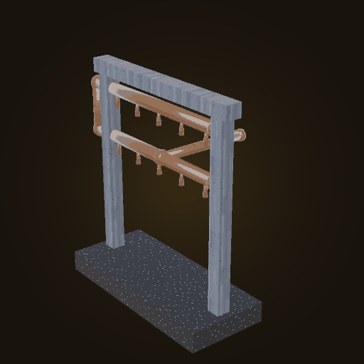 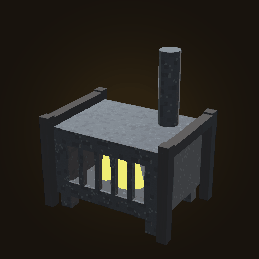 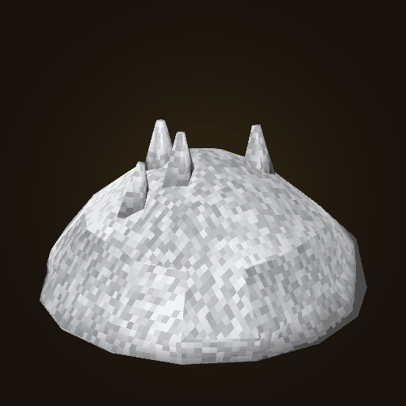

- **Sulfur**: Sulfurous Mud in the swamp, plus Blob and Oozer drops; one Writhan (Ashlands) in five drops 3-5.

  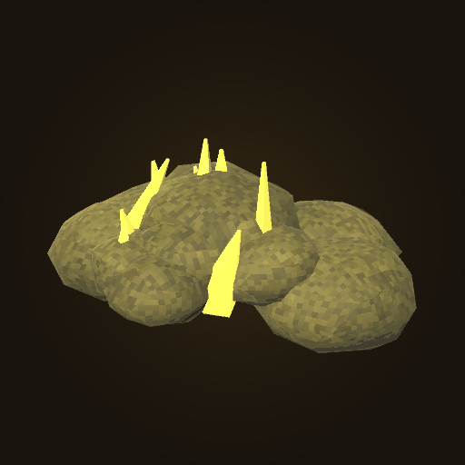

- Emptied guano and mud deposits refill after 2 in-game days.
- **Powder Mill**: fill it with Saltpeter, Charcoal and Sulfur (3 + 1 + 1 per 5 Gunpowder) and it grinds by itself in 10 minutes; the Gunpowder piles up until you take it. Three extension pieces (Obsidian Grindstone, Dvergr Powder Sieve, Flametal Drying Oven) each make the batch bigger and the run 2.5 minutes shorter.

  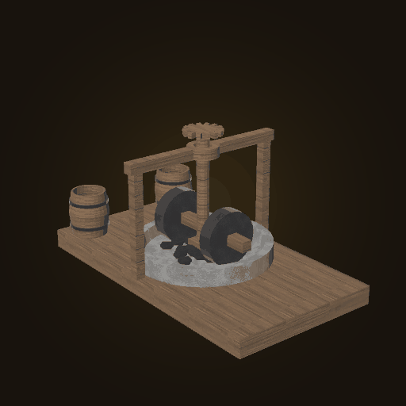 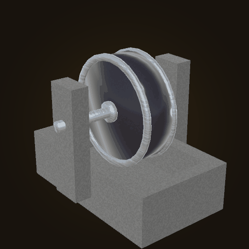 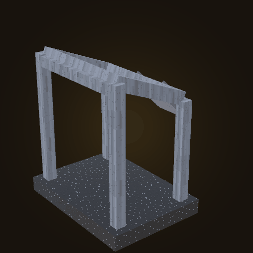 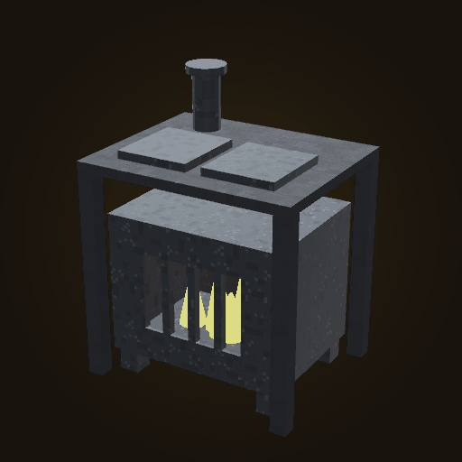 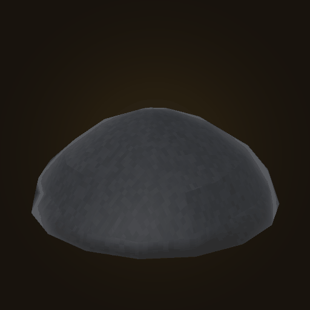

- **Extensions** count within 5 m of their station, above and below too. They snap side by side to their own station and can never stand on top of it.

**Weapons**
- **Spiked Grenade**: hold the attack button to aim the landing spot (arc and ring shown), release to throw, block to cancel. It lands, its fuse burns 1-3 s (Explosives skill), then it bursts. Damages creatures, buildings, trees and rocks, chips rock and ore like a light pickaxe and digs a hole up to 1.5 m deep.

  

- **Cannon** (with **Cannon Stock** and **Iron Cannon Ball**): build the stock, mount the cannon, load the ball at the muzzle, light the fuse with a Torch and stand clear. It also takes the Flametal Cannon Ball. Cannon balls stack to 50.

  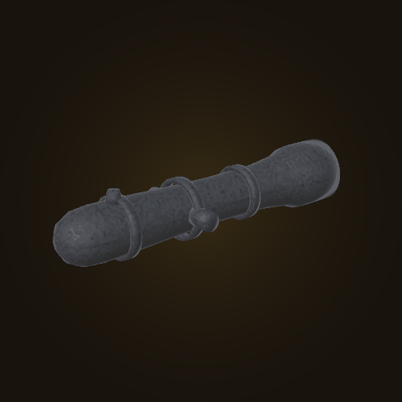 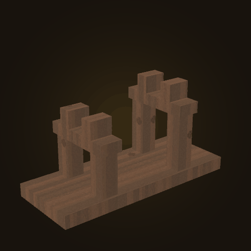 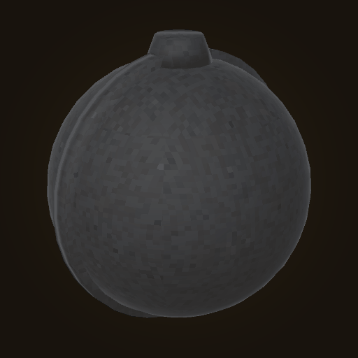 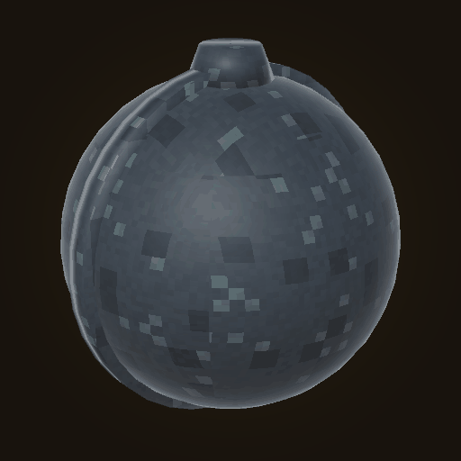

- **Iron Musket**: holds 5 Iron Cartridges, fires at least 0.8 s apart, **R** reloads one cartridge per 1.8 s (1.2 s with the Muskets skill at 100; key can be changed). When the last cartridge is fired, the reload starts by itself if you carry a cartridge. Recoil pushes you back. Counter next to the crosshair; key hints in the bottom right.

  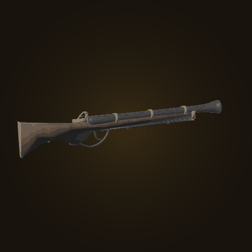 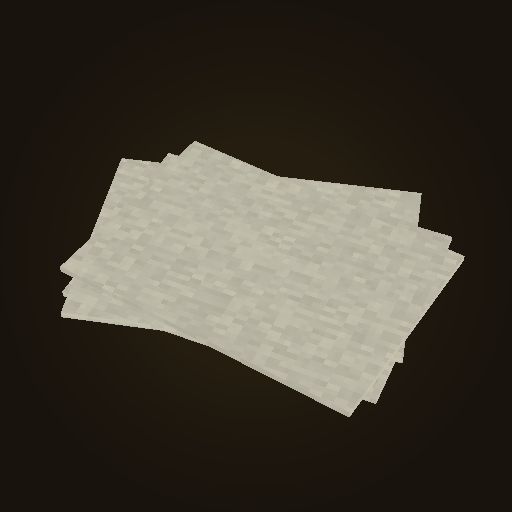 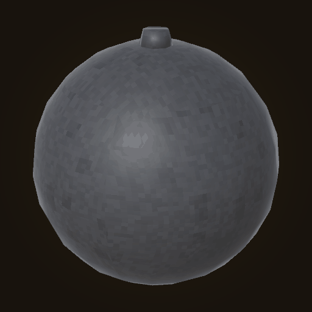 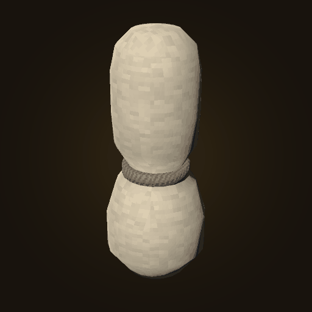

  - **Running** lowers it to your right side, held under the stock. It stays there until you click the **mouse wheel** (aim key, can be changed): it comes back into both hands. In both hands your character turns with the camera and strafes with the direction keys.
  - You can reload while running, but not while jumping or swimming.
  - While it hangs at your side the left hand is free for a **Torch** or a **Shield** (the shield blocks). Raising the musket puts them away.
  - It blocks like a light weapon (block 10, 15 at Blocking 100; parry bonus 1.5) and does not slow you down.
  - A dodge roll keeps it in your right hand and does not lower it when aimed.
- **Explosive Arrow**: ammo for any bow; bursts on impact (3 m) and damages buildings too.

  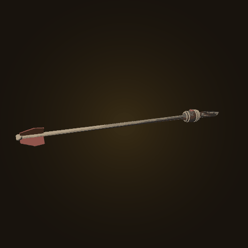

- **Dynamite**: set it down (your character kneels and stands up again; the stick sparkles light red until lit), light it with a Torch (5 s fuse, 3 s with the Explosives skill at 100), 4 m blast for buildings, rocks, trees and ore; creatures take a fifth of that; leaves a round crater up to 3 m deep, measured from the ground under the stick (also when it lies on a rock).

  

- **Deep North Dynamite Pack**: four sticks of dynamite and two grenades strapped together; unlocked after Fader is dead. Set it down, light it with a Torch (4 s fuse, countdown shown to everyone within 30 m) and run: the 20 m blast breaks even the frozen gammel trolls of the Deep North and leaves a 5 m crater.

  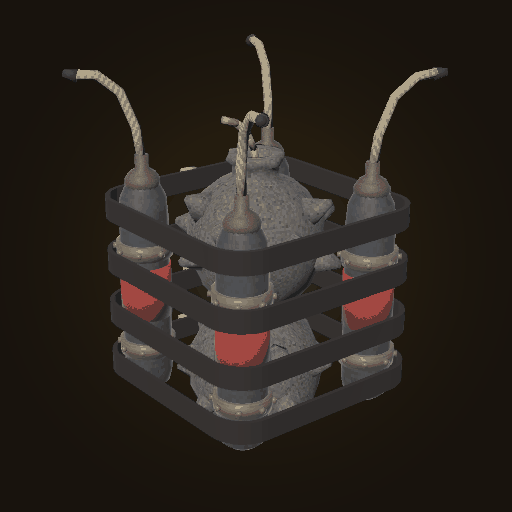

- **Mobile Cannon** (Ashlands): a field gun on wheels, 2500 health, immune to fire, lava and Ashlands ash (falling lava rocks still hurt it).

  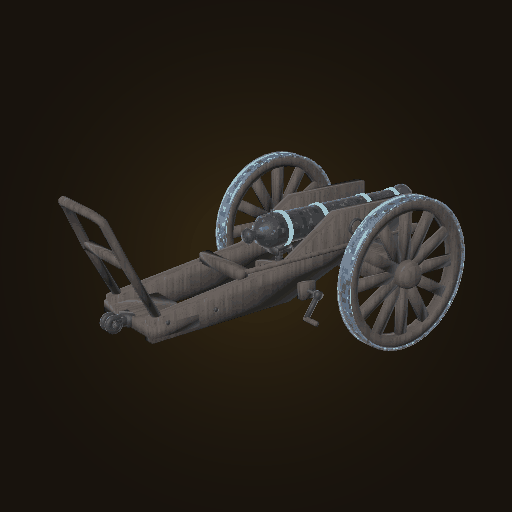

  - **Move it by hand**: E on the push handle (look at the handle; E anywhere else on the cannon loads it). It is slow (about 3.5 m/s) and uses stamina.
  - **Aim**: look at the crank and turn the mouse wheel to set the elevation (-5 to 25 degrees). Turn the whole carriage to aim left or right.
  - **Load and fire**: E at the muzzle loads 3 Gunpowder and 1 **Flametal Cannon Ball** (4 Flametal at the Black Forge; the Iron Cannon Ball does not fit). Then E on the touch hole with a Torch in hand lights the fuse. A loaded cannon stays loaded after a relog.
- **Asksvin Harness**: put it on a tame, saddled Asksvin, the same way as the saddle. Then E on the cannon's tow ring hitches the cannon behind the Asksvin.

  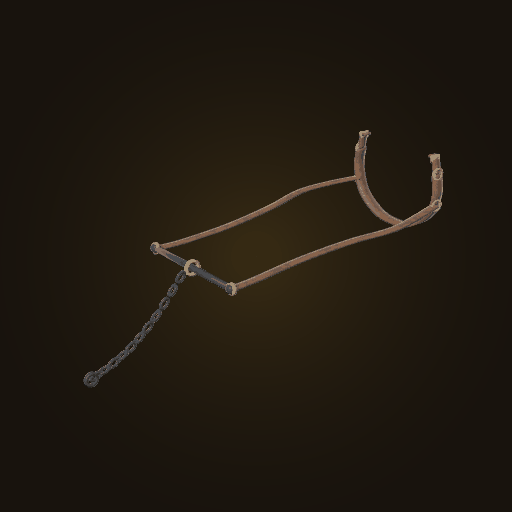

  - The Asksvin tows the cannon at its full speed, ridden or following you; the cannon steers around trees and rocks in its way.
  - E on the tow ring again unhitches it.
  - The harness drops when the saddle comes off or the Asksvin dies.

**Skills** (in the game's Skills window; they rise as you use them)
- **Explosives**: shorter fuses. Dynamite burns 5 s at level 0 down to 3 s at level 100. A Spiked Grenade lands and burns 3 s at level 0 down to 1 s at level 100 before it bursts.
- **Muskets**: faster reloading, 1.8 s per cartridge at level 0 down to 1.2 s at level 100.
- **Cannons**: faster loading (4 s at level 0 down to 2.5 s at level 100) and harder shots (the cannon's blunt damage up to x1.5).

- **Gamepad:** the musket also works with a controller (Aim = secondary attack, Reload = Use, both changeable in the settings). Controller support is offered but has not been tested with a real controller yet.

All pieces and items are listed in the KY-Items viewer (grid or list view).

## How to use
- Requires **KydlCore** (installed automatically by the mod manager).
- Build pieces of this mod are in the hammer's **KY-Items** category.

## Configuration
`BepInEx/config/com.kydldev.GunPowdered.cfg` (or the in-game config manager):

| Section | Setting | Default | What it does |
|---------|---------|---------|--------------|
| General | Enable Mod | true | Switches the whole mod on / off while playing |
| DebugLog | Enable | false | Detailed lines in the BepInEx log for bug reports |
| General | Enable Grenades / Cannons / Musket / Explosive Arrows / Dynamite | true | Switches one weapon type on / off (both cannons share one) |
| Musket | Reload Key | R | Key that reloads the musket |
| Musket | Aim Key | Mouse2 (mouse wheel click) | Raises the lowered musket to the shoulder |
| General | KY-Items View | Grid | KY-Items viewer: grid or list |

Edits to the file are picked up while the game runs.

A shot deals the weapon's damage plus its ammunition's: the ball or cartridge adds pierce damage, and a cannon ball decides what it can break. Damage, recipes, tiers and more: see the FAQ.

## For mod developers
`GunPowderedApi` exposes the prefab names and a small weapons part: musket load (read / set), capacity and stats, and a `ShotFired` event.

## Multiplayer
The server and every player need the mod, all with exactly the same version (a player without it, or with another version, cannot join).

## Bug reports
Turn on `[DebugLog] Enable`, reproduce the problem, and attach `BepInEx/LogOutput.log`.

---

## Get help and stay in touch
Questions, bug reports, ideas or mod requests? Come say hi in the **KydlDev Discord**: **https://discord.gg/tX2CcTNC4W**
Everyone is welcome, and it is the quickest way to reach me. Source code and issues: https://github.com/kydlDev
