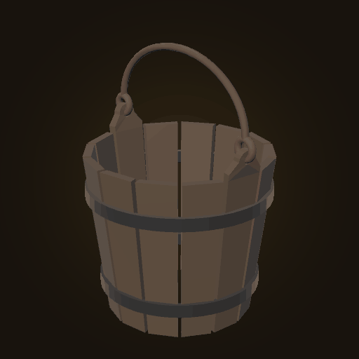
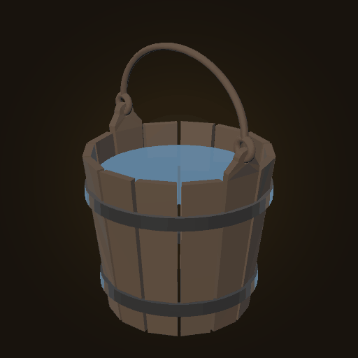
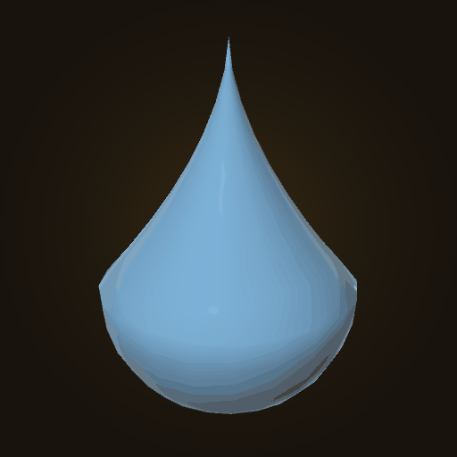
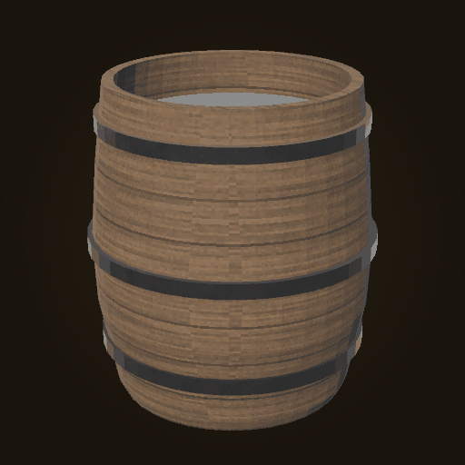

How do I get water?

- Bucket (8 Wood, 1 Bronze, 2 Leather Scraps at the Workbench): hold it, face any water and use it. One full bucket gives 10 Water.

    
- Rain Barrel (10 Wood, 2 Resin, 1 Bronze): fills by itself while it rains, 5 Water per minute, up to 200. It only fills under open sky, so do not build a roof over it.

  
