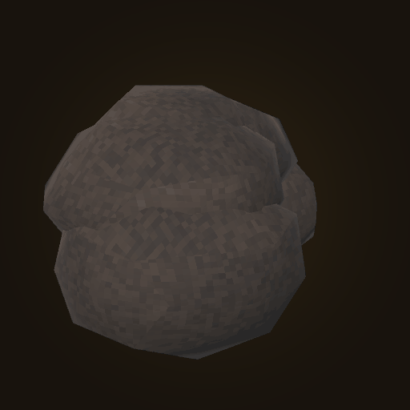
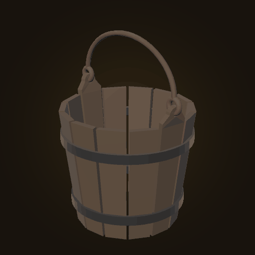
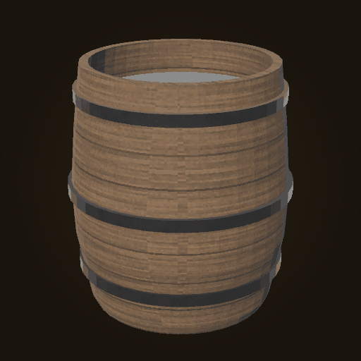
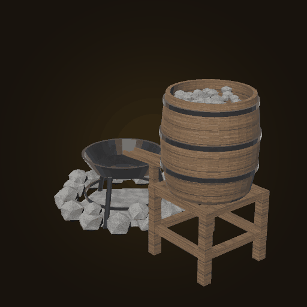
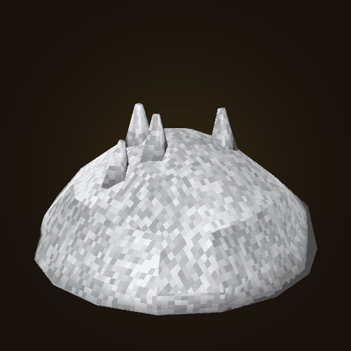
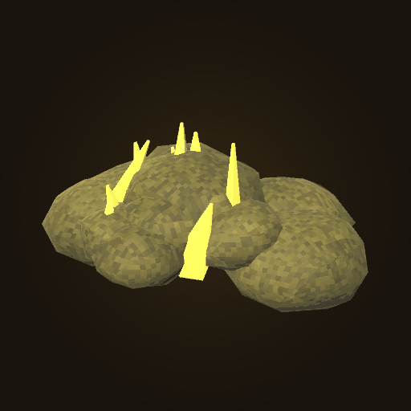
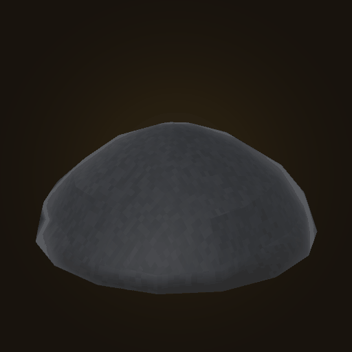
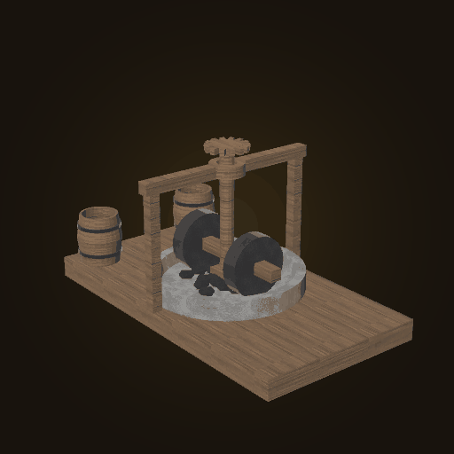

How do I make gunpowder?

1. Collect Bat Guano (caves) and Water (Bucket or Rain Barrel).

    
2. Leaching Station: every 10 Bat Guano + 10 Water + 4 Wood give 5 Saltpeter. One run takes 30 minutes (one in-game day); extensions make the batches bigger and the runs shorter.

   
3. Collect Sulfur (Sulfurous Mud in the swamp, or Blobs and Oozers) and Charcoal (Charcoal Kiln).

  
4. Powder Mill: 3 Saltpeter + 1 Charcoal + 1 Sulfur make 5 Gunpowder.

   
Leaching Station: 30 Wood, 15 Stone, 6 Bronze, 2 Resin. Powder Mill: 40 Wood, 20 Stone, 5 Bronze. Both at the Workbench.
