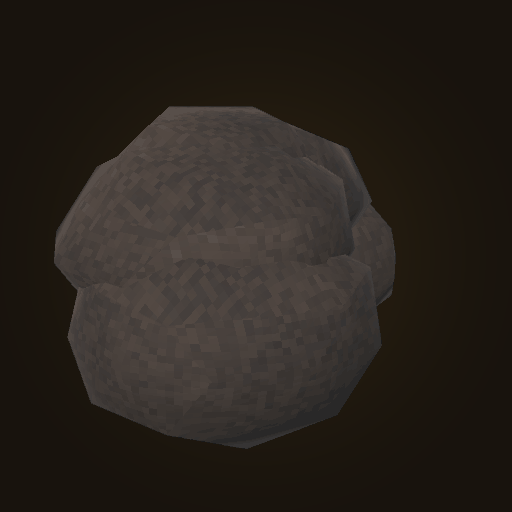
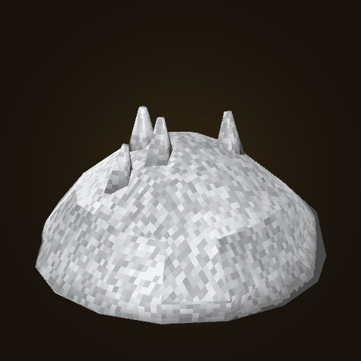
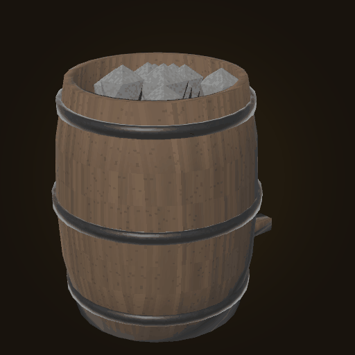
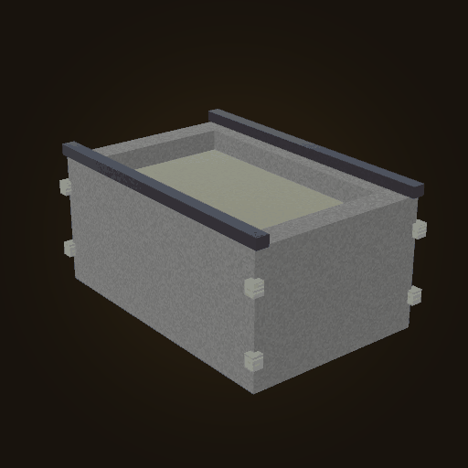
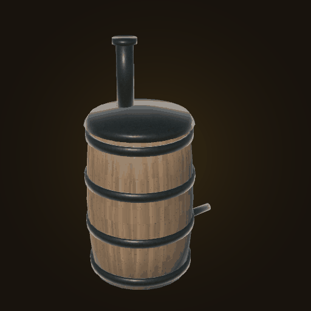
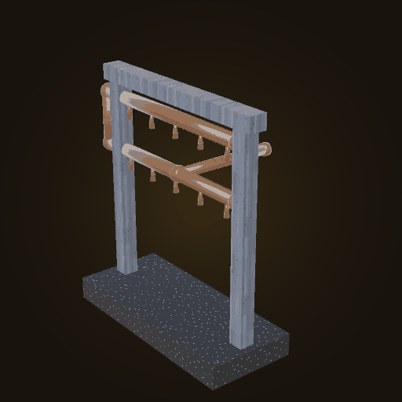
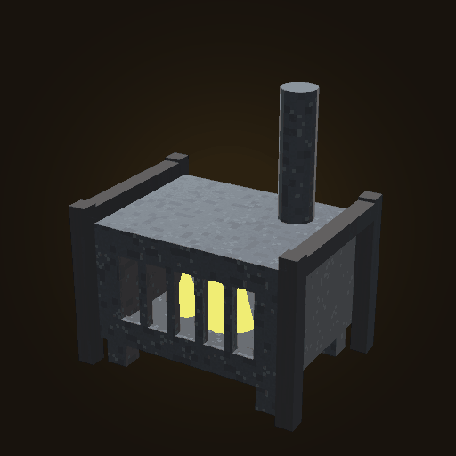

How do I upgrade the Leaching Station?

Build extension pieces within 5 m of the station (hammer, at a Workbench). Each different extension is one upgrade: the station holds a bigger batch and leaches 5 minutes faster. It still starts as soon as one 10 + 10 + 4 portion is inside; a run takes every whole portion inside, up to the station's batch.
- No extension: 10 Bat Guano + 10 Water + 4 Wood -> 5 Saltpeter in 30 min.

   

- Second Leaching Barrel (Swamp): 20 + 20 + 8 -> 10 in 25 min.

  

- Settling Tank (Mountains): 30 + 30 + 12 -> 15 in 20 min.

  

- Black Metal-banded Boiler (Plains): 40 + 40 + 16 -> 20 in 15 min.

  

- Dvergr Drip Pipes (Mistlands): 50 + 50 + 20 -> 25 in 10 min.

  

- Flametal Heater (Ashlands): 60 + 60 + 24 -> 30 in 5 min.

  

The order does not matter and two of the same kind count once. The hover text shows the station's upgrades.
