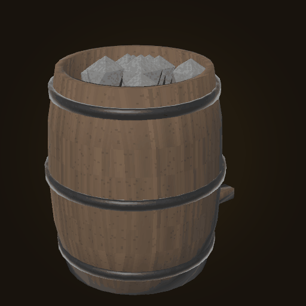
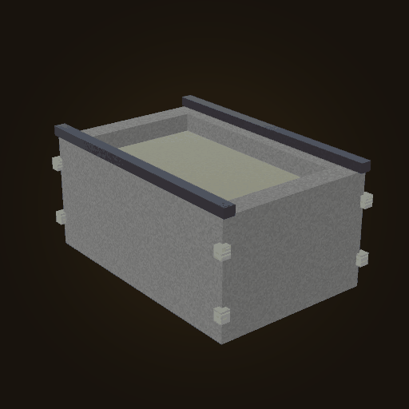
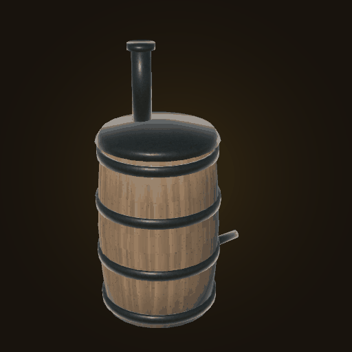
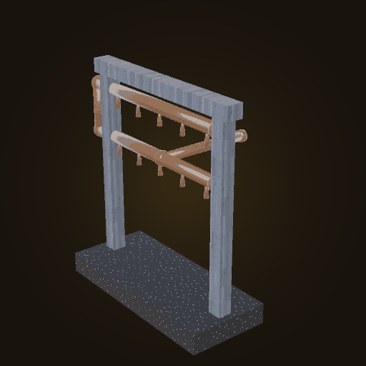
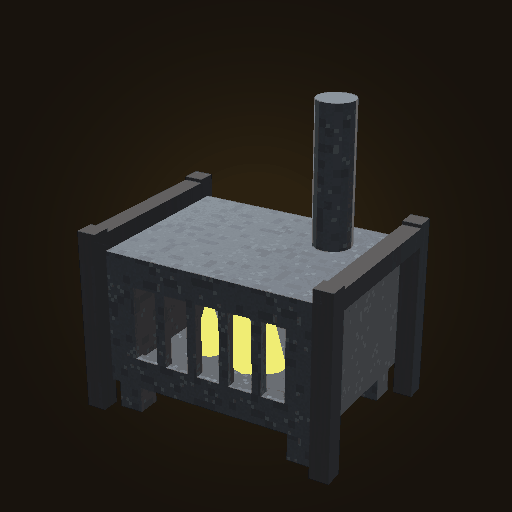
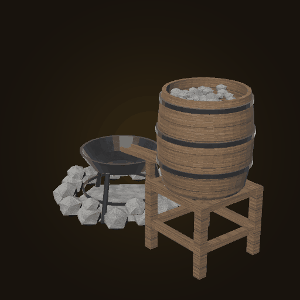
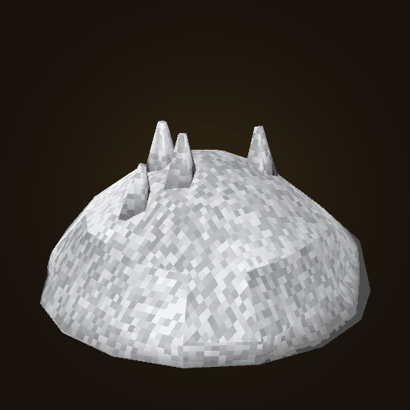

What do the Leaching Station extensions cost?

All are built with the hammer at a Workbench:
- Second Leaching Barrel: 20 Wood, 4 Iron, 4 Resin.
  
- Settling Tank: 20 Stone, 4 Silver, 4 Obsidian.
  
- Black Metal-banded Boiler: 10 Fine Wood, 6 Black Metal.
  
- Dvergr Drip Pipes: 6 Copper, 10 Yggdrasil Wood, 10 Black Marble.
  
- Flametal Heater: 6 Flametal, 10 Ashwood.
  
They are switched on and off together with the Leaching Station ([General] Enable Saltpeter).

 

