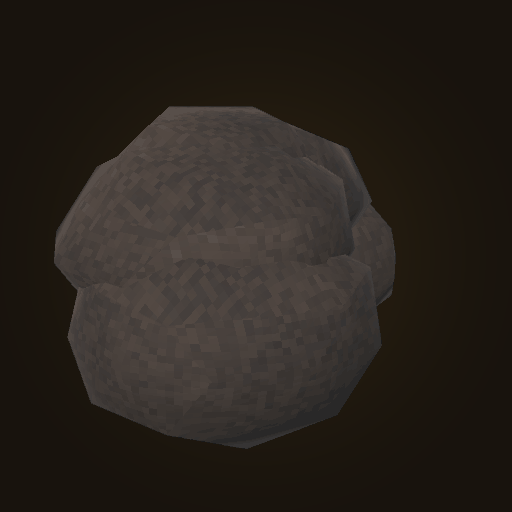
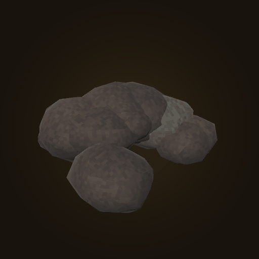

Where do I find bat guano?

In caves, the first time anyone walks in:

 

- Troll Caves and Burial Chambers (Hildir's crypt too): rare, 1-2 deposits with 1-2 guano each.
- Mountain caves (Hildir's cave too): up to 3 deposits with 1-4 guano each.
- Swamp areas where bats live: occasional deposits.
Mine it with any pickaxe. An emptied deposit fills up again after 2 in-game days.
