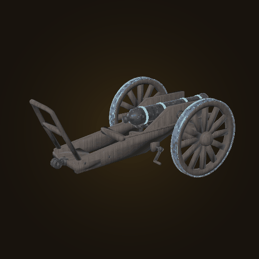
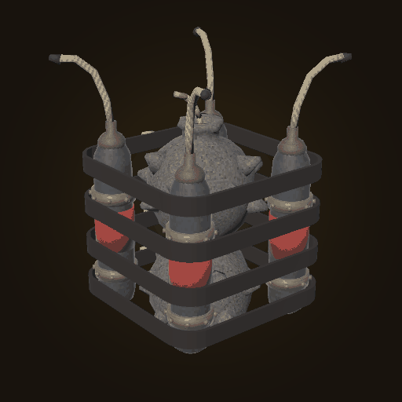
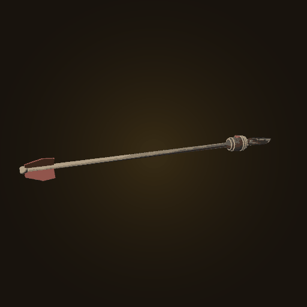

Do the weapons set things on fire (damage over time)?

Yes. Every gunpowder weapon sets creatures it hits burning for 5 seconds:
- Iron Musket, Spiked Grenade, Dynamite: 5 fire damage per second (25 in total).

    
- Hand Cannon and Mobile Cannon: 10 per second (50 in total).

   
- Deep North Dynamite Pack: 30 per second (150 in total).

  
The Explosive Arrow's burst deals its 5 fire damage once instead of burning.

Each explosion hits a creature only once; the burning comes on top of that hit.
