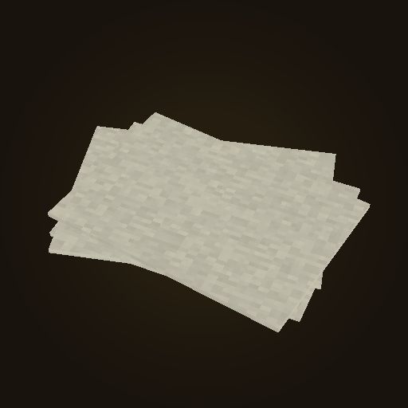
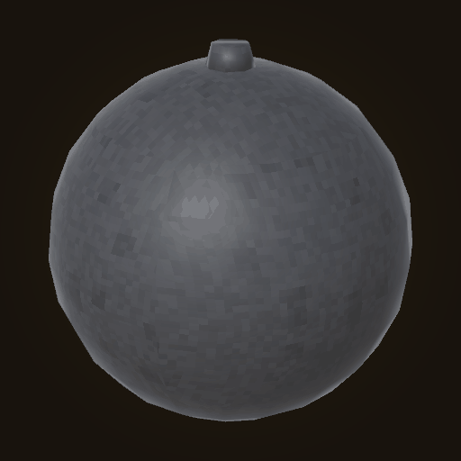
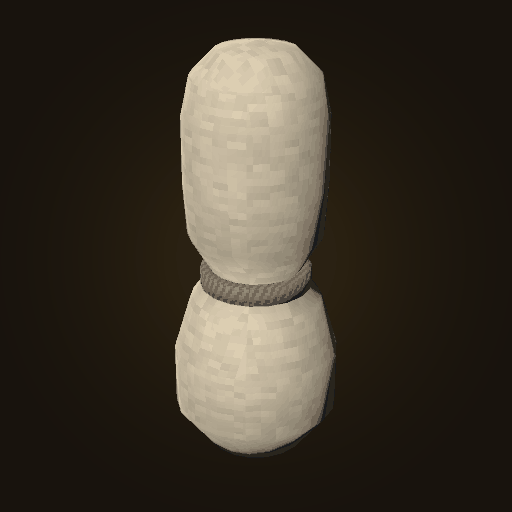

How do I make ammunition for the Iron Musket?

The musket loads Cartridges, never loose bullets:
1. Paper: 2 Resin + 1 Leather Scraps at the Workbench.

  
2. Iron Bullet (5): 1 Iron at the Forge level 2.

  
3. Cartridge: 1 Gunpowder + 1 Iron Bullet + 1 Paper at the Workbench level 2.

  
Press R (Reload Key setting) to load one cartridge every 1.8 s (1.2 s with the Muskets skill at 100), up to 5. You can reload while running, but not while jumping or swimming. Each shot uses one; shots are at least 0.8 s apart.
