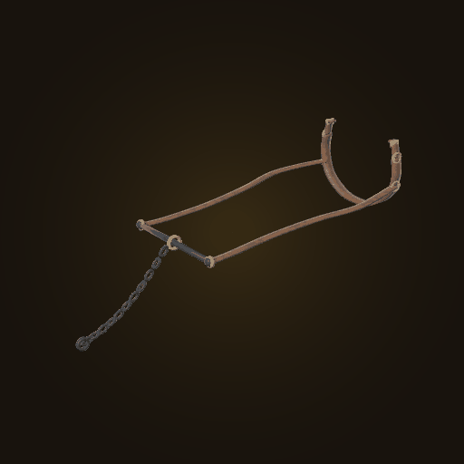

How do I tow the Mobile Cannon with an Asksvin?

Put a saddle and the Asksvin Harness on a tame Asksvin (the harness goes on like the saddle). Then E on the cannon's tow ring hitches the cannon behind it. The Asksvin pulls it at full speed, ridden or following you. E on the tow ring again unhitches it. The harness drops when the saddle comes off or the Asksvin dies. Without an Asksvin you can push the cannon by hand (E on the handle), slowly and at the cost of stamina.

 

