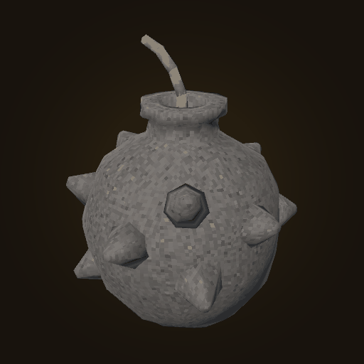
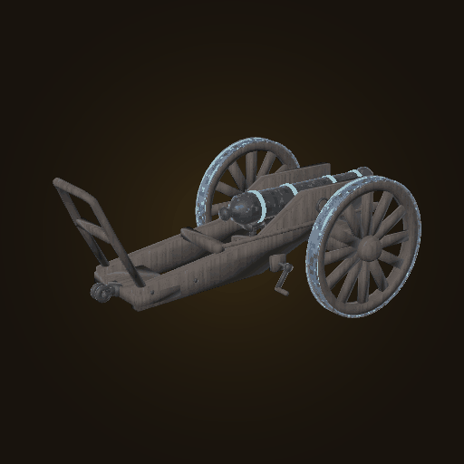

How do the GunPowdered skills work?

The mod adds three skills to the game's Skills window. They rise as you use them and fall on death like the others.
- Explosives (lighting dynamite, throwing grenades): dynamite burns 5 s at level 0 down to 3 s at level 100; a Spiked Grenade lands and burns 3 s down to 1 s before it bursts.

   
- Muskets (hits with the Iron Musket, loading cartridges): reloading takes 1.8 s per cartridge at level 0 down to 1.2 s at level 100. The musket trains Muskets, not Crossbows.

  
- Cannons (each shot): loading takes 4 s at level 0 down to 2.5 s at level 100, and the cannon's blunt damage grows up to x1.5. This counts for the Cannon and the Mobile Cannon.

   
