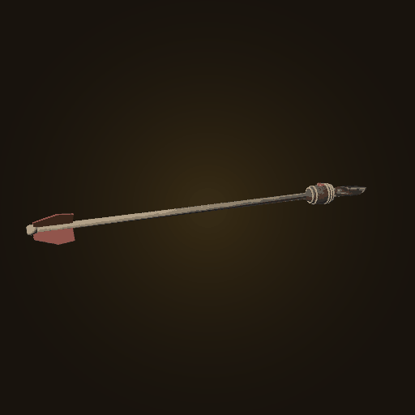
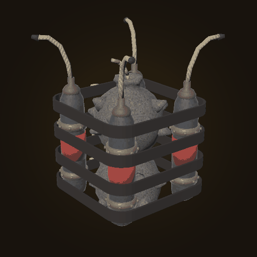
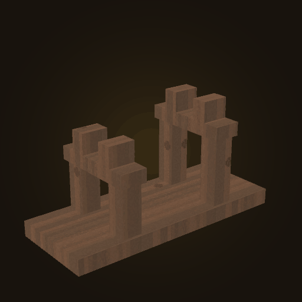
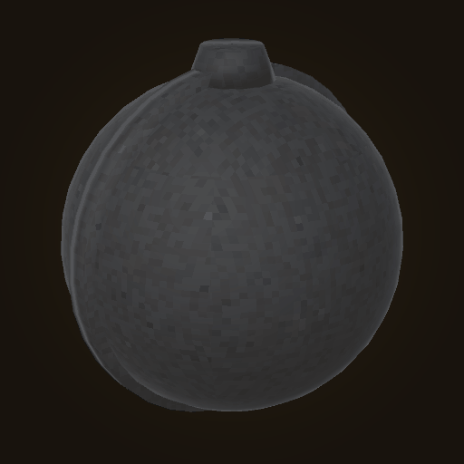
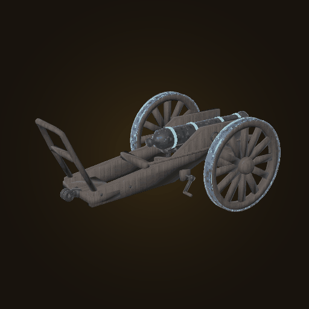
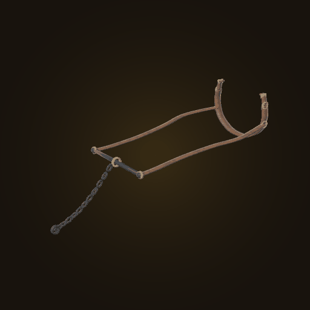

What are the weapon recipes?

- Spiked Grenade (5): 3 Gunpowder, 2 Obsidian, 2 Stone, 1 Resin - Workbench level 3.

  

- Iron Musket: 15 Iron, 10 Wood, 2 Bronze - Forge level 2.

  

- Explosive Arrow (10): 8 Wood, 1 Black Metal, 2 Feathers, 2 Gunpowder - Forge level 4.

  

- Dynamite (5): 2 Iron, 5 Gunpowder, 1 Resin - Forge level 2.

  

- Deep North Dynamite Pack: 4 Dynamite, 2 Spiked Grenades, 4 Seal Hide - Forge level 2, after Fader.

  

- Hand Cannon: 20 Iron, 5 Wood, 5 Resin - Forge level 2.

  

- Cannon Stock (hammer): 10 Wood, 4 Resin - near a Workbench.

  

- Cannon Ball: 2 Iron - Forge level 2.

  

- Mobile Cannon (hammer): 20 Flametal, 30 Ashwood, 10 Iron - near a Forge.

  

- Asksvin Harness: 10 Lox Pelt, 3 Chain, 2 Flametal, 2 Bronze - Workbench level 2.

  
