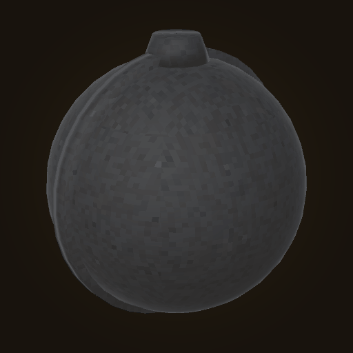
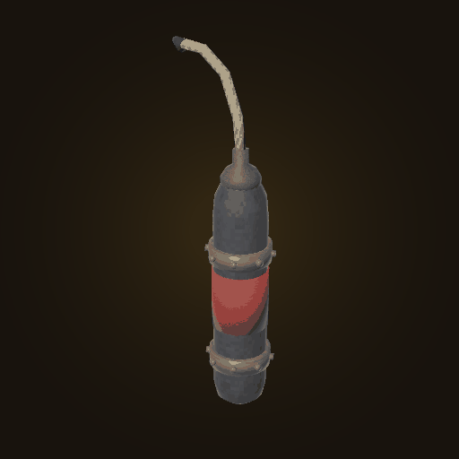
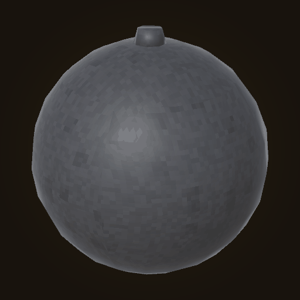
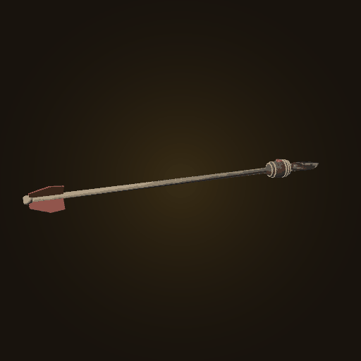
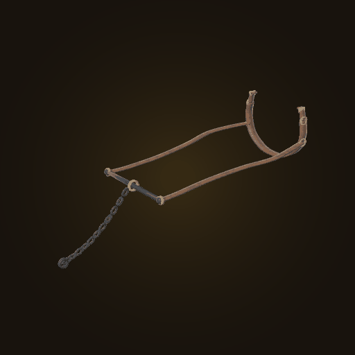
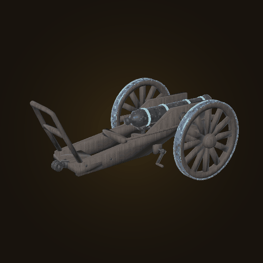
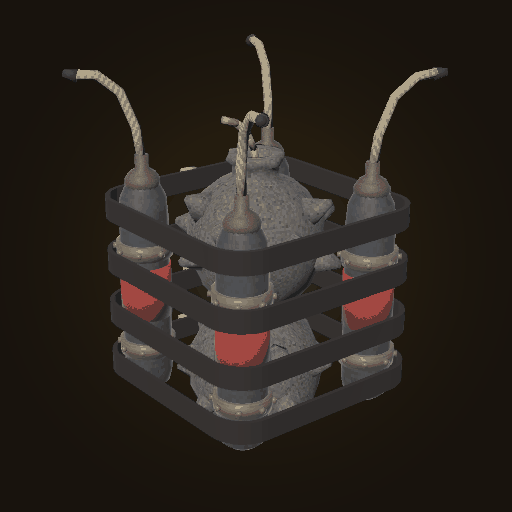

When can I make each weapon (tiers)?

- Iron Musket and its Iron Bullets, Hand Cannon, Cannon Ball, Dynamite: Swamp / iron age, Forge level 2.

      
- Spiked Grenade: Mountains (needs Obsidian), Workbench level 3.

  
- Explosive Arrow: Plains (needs Black Metal), Forge level 4.

  
- Mobile Cannon and Asksvin Harness: Ashlands (Flametal, Ashwood, Lox Pelt).

   
- Deep North Dynamite Pack: only after Fader, the Ashlands boss, is dead.

  
Gunpowder itself becomes possible once you have Bronze for the Leaching Station and Powder Mill.
